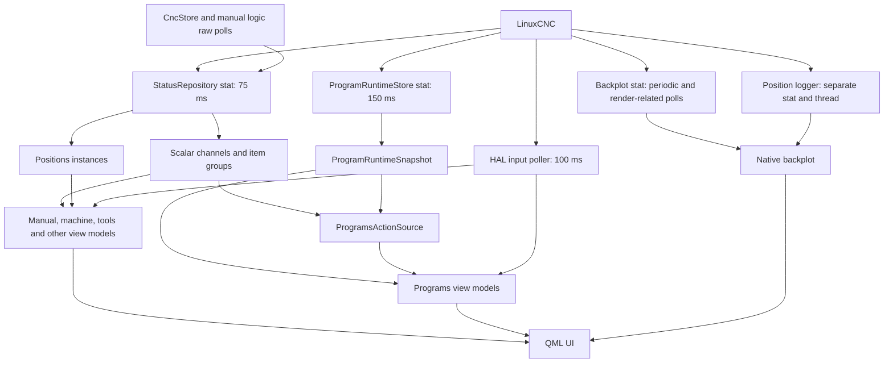
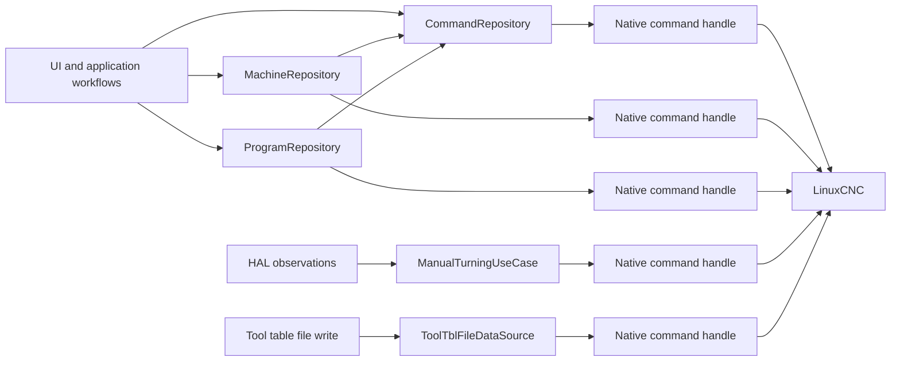
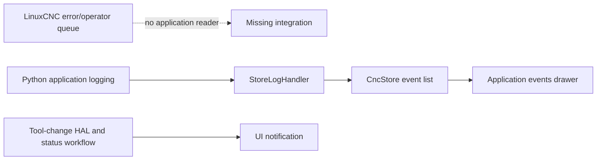
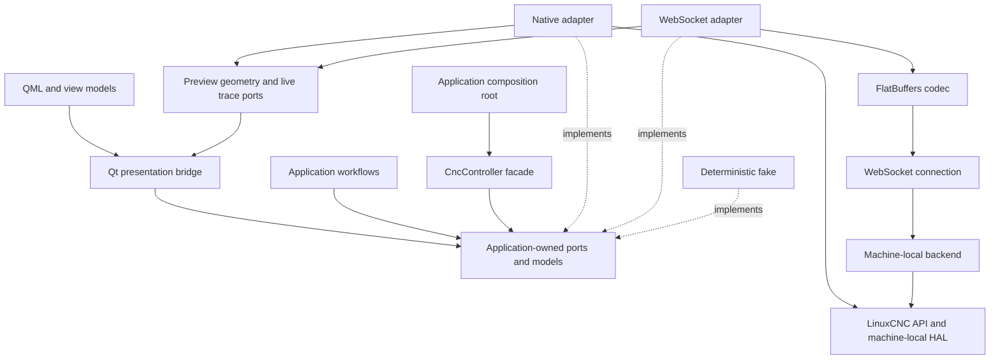

# Architecture review: isolating LinuxCNC behind a transport-independent interface

Date: 23 October 2026

Scope: architectural investigation of the existing implementation. This document proposes changes; it does not implement them. The investigation used static code inspection, existing tests, the locally available LinuxCNC binding source, and the primary references listed below. Tests were inspected, not executed as part of the investigation.
nu 
## 1. Conclusion

Adopt explicit application-facing ports, immutable application-level state models, native and future remote adapters, and constructor injection. Introduce them incrementally around the existing repositories and view models rather than replacing the application in one rewrite.

A central facade is a useful first milestone, but wrapping native `stat` and `command` objects while continuing to expose them would not provide transport independence. Ordinary application consumers must eventually depend on typed snapshots, semantic commands, command outcomes, connection health, and notification events.

The main obstacles are broader than the number of LinuxCNC imports:

- Status is sampled independently and also read directly, producing multiple views of machine state with different timing.
- Command sequencing and interpretation of completion are distributed across repositories and UI-related workflows.
- Native calls can block the Qt event loop; moving these particular bindings into a Python thread is not necessarily sufficient.
- HAL interactions, local program files, configuration, tool-table reloads, and the native backplot are additional boundaries a remote implementation must address.
- There is no integrated LinuxCNC error-channel reader, and polling failures do not consistently invalidate displayed state.

Keep Qt at the presentation and scheduling boundary where practical. Keep deterministic machine inputs and motion control in LinuxCNC/HAL. Do not introduce a general command bus, dependency-injection framework, or asyncio merely to establish these boundaries.

## 2. Current architecture and composition

The application uses Qt properties, signals, and timers extensively. Existing classes called repositories combine several different responsibilities: persisted data, live state observation, command dispatch, native integration, and application workflows.

The effective composition root begins in [`src/teachinlathe/__init__.py`](src/teachinlathe/__init__.py), in `main()`, which prepares configuration and the Qt application, creates `Application` and `AppWindow`, schedules post-GUI HAL initialization, and enters the event loop.

[`app/application.py`](src/teachinlathe/app/application.py), `Application.__init__`, initializes the INI, status, commands, machine, HAL component, tool library, and fixtures through singleton accessors. This establishes initialization order, but does not yet establish explicit ownership of all dependencies.

[`app/app_window.py`](src/teachinlathe/app/app_window.py), `AppWindow._buildViewModels`, constructs the view models. Many of their dependencies still come from module globals or default singleton lookups instead of being supplied by this root.

[`core/__init__.py`](src/teachinlathe/core/__init__.py) eagerly imports native-dependent modules. Consequently, importing application code through this package can require LinuxCNC even when a test intends to replace the actual machine connection.

## 3. Dependency inventory

### Status objects and polling

There are four explicit `linuxcnc.stat()` construction sites in the application code reviewed. Two belong to backplot integration, including its position logger.

| File / component | Important methods | Dependency and behavior |
| --- | --- | --- |
| [`core/status_repository.py`](src/teachinlathe/core/status_repository.py), `StatusRepository` | `__init__`, `poll`, `stat`, `__getattr__` | Creates the shared native status object. Polls on a 75 ms Qt timer. Exposes the raw object and dynamically creates `StatusChannel` objects. Updates scalar channels and `ItemStatus` groups sequentially before emitting `polled`. |
| [`programs/model/program_runtime.py`](src/teachinlathe/programs/model/program_runtime.py), `ProgramRuntimeStore` | `__init__`, `poll`, `_build_snapshot` | Creates a second status object and polls every 150 ms. Builds a frozen `ProgramRuntimeSnapshot`, exposes native status, and emits field and snapshot notifications. |
| [`ui/tabs/programs/backplot/lathe_backplot_item.py`](src/teachinlathe/ui/tabs/programs/backplot/lathe_backplot_item.py), `LatheBackplotCanon` | `__init__`, `poll`, `redraw`, `realize`, `_reload_preview`, `_refresh_preview_wcs` | Creates a status object for native preview integration and polls in several paths. Its periodic interval defaults to 40 ms and is configurable through `TEACHINLATHE_POLL_MS`. |
| Same backplot module | `__init__` | Passes another newly created status object to `linuxcnc.positionlogger`. Starts its native logger through `_thread.start_new_thread`, with a 10 ms interval argument. |

Additional callers poll the shared raw status object without going through `StatusRepository.poll`: notably `CncStore.refreshStatus` and manual-turning logic. They can therefore advance the native object without simultaneously advancing its cached channels.

`StatusRepository` logs a poll failure once and retains cached values. `ProgramRuntimeStore` also retains its previous snapshot when polling fails. Neither provides a sufficient public freshness/connection contract for consumers to distinguish a current value from an old one.

### Command objects and command consumers

There are six explicit command-construction sites: five retained command handles and one conditional preview synchronization handle. Commands are not routed through one shared sequencer.

| File / class | Important methods | Responsibility and coupling |
| --- | --- | --- |
| [`core/command_repository.py`](src/teachinlathe/core/command_repository.py), `CommandRepository` | `__init__`, `issue_mdi`, `can_issue_mdi`, `set_task_mode`, `_restore_mode_when_idle` | Owns a command object; switches modes and submits MDI. Keeps one `_previous_mode` and restores it based on an idle observation. A successful return from `issue_mdi` is not proof of completed machine action. |
| [`core/machine_repository.py`](src/teachinlathe/core/machine_repository.py), `MachineRepository` | `__init__`, `_home_joint`, machine-state and homing methods | Owns another command object for state, teleoperation, homing, and unhoming, while using `CommandRepository` for mode changes. Axis letters are mapped to configured joints. |
| [`core/program_repository.py`](src/teachinlathe/core/program_repository.py), `ProgramRepository` | `__init__`, `load`, `run`, `pause`, `resume`, `step`, `abort`, `clear` | Owns another command object. Uses shared mode switching followed by its own program command. `load` calls `wait_complete` but does not evaluate its return before reporting success. |
| [`manual/logic/manual_turning_use_case.py`](src/teachinlathe/manual/logic/manual_turning_use_case.py), `ManualTurningUseCase` | `__init__`, `_listen`, `_handle_spindle_switch`, `_can_handle_manual_operations` | Creates its own command handle. Mixes spindle commands, MDI/mode changes, raw status polling, HAL reactions, and readiness policy. CSS handling includes synchronous waits. |
| [`core/tool_tbl_file_data_source.py`](src/teachinlathe/core/tool_tbl_file_data_source.py), `ToolTblFileDataSource` | `__init__`, `write`, `_linuxcnc_command` | Retains a native command handle to reload the tool table after writing a local file. A reload failure is logged but does not necessarily make the file-write operation report failure. |
| [`ui/tabs/programs/backplot/lathe_backplot_item.py`](src/teachinlathe/ui/tabs/programs/backplot/lathe_backplot_item.py), `LatheBackplotCanon` | `_reload_preview` | Conditionally constructs a command object for `task_plan_synch` when synchronization is requested. The normal/default path does not request it. |

### State consumers and workflow dependencies

| File / component | Important methods / behavior | Architectural significance |
| --- | --- | --- |
| [`app/app_state.py`](src/teachinlathe/app/app_state.py), `CncStore`, `StoreLogHandler` | Module-level `STATUS`; `refreshStatus`, `submitCommand`, `StoreLogHandler.emit` | Starts a dependency at import time. Refreshes every 500 ms, directly polls raw status, then may prefer older cached channels. Its displayed machine state uses native RCS state. Stores application log events, not LinuxCNC error-channel events. |
| [`core/positions_repository.py`](src/teachinlathe/core/positions_repository.py), `Positions` | `__init__`, `_update` | Holds raw status and transforms positions using offsets, rotation, unit conversion, and display conventions. Several view models create their own instance. This math should become independently testable from transport. |
| [`programs/model/programs_action_source.py`](src/teachinlathe/programs/model/programs_action_source.py), `ProgramsActionSource` | Module globals `STATUS` and `STAT`; `__init__`, `refresh` | Combines runtime snapshots, shared status channels, raw status, native constants, and HAL state. `refresh` calls runtime polling; snapshot notification can invoke `refresh` again. |
| [`ui/tabs/programs/ProgramsViewModel.py`](src/teachinlathe/ui/tabs/programs/ProgramsViewModel.py), `ProgramsViewModel` | `__init__`, program-load and runtime handlers | Constructs runtime/action/tool-change components; maintains additional execution flags such as `_was_active`, `_run_started`, `_abort_requested`, and `_program_completed`. Marks a program loaded in response to a request event before actual native load confirmation. |
| [`ui/tabs/programs/filesystemview/FileSystemBridge.py`](src/teachinlathe/ui/tabs/programs/filesystemview/FileSystemBridge.py) | `load_or_reload_program`, `openFileByAbsolutePath` | Uses local paths and emits program-load/UI transitions without propagating a confirmed load outcome. |
| [`programs/model/program_stack.py`](src/teachinlathe/programs/model/program_stack.py), `ProgramCallStackResolver` | Stack resolution and source lookup | Uses INI search paths and local source files. A remote backend requires an explicit program-artifact/content boundary. |
| [`core/tool_library_repository.py`](src/teachinlathe/core/tool_library_repository.py), `ToolLibraryRepository` | `load_tool`, `touch_off`, `_poll_touch_off`, `_restore_tool`, `_issue_restore` | Combines stored tooling, live state, MDI, and workflow state. Touch-off completion relies on busy/idle observations and a polling fallback. Deferred restoration needs current-state validation when it executes. |
| Manual DRO view model, `TeachInLatheDroViewModel` | `_set_z_datum`, `onLimitsChanged` | Reads status and transformed positions, submits G10 datum changes, and writes HAL values. UI presentation and machine integration are mixed. |
| `MachineViewModel` | Constructor and machine/MDI slots | Already supports some dependency injection, but defaults to native-dependent repositories. |
| `ProgramRunViewModel` / `MachineRunSource` | Feed/spindle presentation | Interprets native motion constants, indexed runtime settings, and actual RPM from HAL. |
| `ProgramsToolChangeViewModel` | `_announce_if_loaded`, confirmation/cancellation handlers | Combines HAL request/confirmation signals, a delayed raw-status tool check, and UI notifications. Short pulses and asynchronous tool loading already require reconciliation. |
| [`programs/logic/programs_use_case.py`](src/teachinlathe/programs/logic/programs_use_case.py), `ProgramsUseCase` | HAL handlers | Observes cycle start/completion/abort and writes program-loaded/ready state into HAL. These are machine-adjacent handshakes, not just UI properties. |

Other indirect dependencies include machine settings, fixtures, machine-limit/configuration helpers, tool-selection views, and conversational generation code that obtains the tool library lazily. Planning geometry should remain separate from live controller communication; supplying tooling data is preferable to importing a native-backed global library inside planning code.

### HAL, configuration, diagnostics, and preview

| File / component | Dependencies and behavior |
| --- | --- |
| [`core/hal_repository.py`](src/teachinlathe/core/hal_repository.py) | Imports `_hal` and HAL types/directions. `HalPin` wraps native pins and emits value changes; `_PinPoller` uses a 100 ms Qt timer for input/IO pins; `HalComponent` owns components, listener registration, readiness, and cleanup. `unload_all` is registered with `atexit`. |
| [`core/lathe_hal_component.py`](src/teachinlathe/core/lathe_hal_component.py), `TeachInLatheComponent` | Declares application-specific joystick, spindle, gear, cover, handwheel, tool-change, limits, program, and cycle-state pins. Exposes the component wrapper to consumers. |
| [`app/dev_panel.py`](src/teachinlathe/app/dev_panel.py), `DevPanelViewModel` | Development process with its own HAL component to simulate machine inputs. Keep this native-specific facility separate from normal application controller ports. |
| [`app/postgui.py`](src/teachinlathe/app/postgui.py), `run_postgui` | Reads INI post-GUI configuration and invokes `halcmd`/`haltcl` subprocesses. This is backend startup integration. |
| [`core/tools_repository.py`](src/teachinlathe/core/tools_repository.py), diagnostics/debug tooling | Uses HAL component checks and launches native LinuxCNC diagnostic applications. Model these as optional native capabilities. |
| Backplot integration | Uses `linuxcnc.ini`, native status, `gcode`, `rs274` preview/rendering facilities, tool rows, parameter files, local G-code, and a position logger. A command/status facade alone cannot make it remote-compatible. |

HAL signals are sampled separately from machine status. The 100 ms Python poller cannot guarantee observation of brief pulses. Real-time HAL logic may correctly process a pulse that the Python UI never sees.

### Native types leaking across boundaries

Native `MODE_*`, `STATE_*`, `INTERP_*`, RCS state, and `MOTION_TYPE_*` constants appear outside adapters. Native position tuples, offset arrays, indexed `settings`, spindle/joint/axis dictionaries, tool rows, and raw stat objects are also consumed across modules.

These representations should be translated once at the adapter boundary. Preserve distinctions currently easy to conflate: task state versus command execution state, axis versus joint indexing, physical homing versus a configuration exemption, and submission versus machine-state completion.

## 4. Current data flows

### Status



Qt signals are the main observer mechanism. However, the general status repository publishes channel changes before the entire sample has been committed. A callback can read a mixture of old and new channels. The runtime store commits a snapshot first, which is a better foundation, but action logic mixes it with the other status source.

### Commands



Multiple handles are not automatically a native API violation, but the application has no unified ordering or correlation policy across them. A logical operation can switch mode through one handle and act through another. Different workflows can interfere with mode restoration or interpret the same idle observation as their own completion.

### Errors and notifications



No `linuxcnc.error_channel()` integration was found in the reviewed application. Application logs and tool-change notifications do not replace it. Use one reader per intended LinuxCNC error stream: reading consumes queued messages, so competing readers can remove messages before another consumer receives them. See the [LinuxCNC Python interface documentation](https://linuxcnc.org/docs/html/config/python-interface.html).

## 5. Main architectural issues

1. **Multiple inconsistent state views.** Poll rates differ, direct native polls bypass channel updates, and some consumers combine independently sampled sources. Repeated `Positions` instances also duplicate transformations.
2. **Partial state publication.** Channel callbacks run during general status updates. Commit one immutable sample before emitting derived property notifications.
3. **Stale state resembles healthy state.** Failed polling preserves old values without a usable freshness contract. Show retained values with explicit stale/disconnected state and gate commands accordingly.
4. **Distributed command workflows.** Mode switching, MDI, spindle operations, program actions, and restoration are not coordinated. A single `_previous_mode` cannot represent overlapping transactions.
5. **Submission and completion are confused.** A method returning normally, a native command acknowledgment, and the requested machine state becoming true are separate outcomes. Program loading and touch-off currently demonstrate this weakness.
6. **Reentrant refresh and unnecessary sampling.** `ProgramsActionSource.refresh` polls a store whose notifications can invoke refresh again. Consumers should react to committed samples rather than initiate polling.
7. **Business rules depend on communication details.** Touch-off, tool restoration, run readiness, and manual spindle control mix native API calls with workflow decisions.
8. **Remote migration includes files and preview.** Local file paths, INI access, tool-table writes, call-stack source resolution, and native preview must be treated explicitly.
9. **Lifecycle ownership is incomplete.** Global dependencies, anonymous signal subscriptions, independently started timers, and logger threads lack a single shutdown sequence.

## 6. Pattern evaluation

| Pattern | Recommendation in this application |
| --- | --- |
| Facade | Use a small `CncController` entry point exposing status, commands, events, and connection lifecycle. Do not make it responsible for all tooling persistence, file browsing, planning, rendering, or UI decisions. |
| Ports and adapters | Recommended target. Application-owned contracts are implemented by native, remote, and fake adapters. Application logic must not import an adapter to obtain types or constants. |
| Adapter | Translate native constants, dictionaries, arrays, error categories, and command semantics into application-level models. Future FlatBuffers decoding ends at the same boundary. |
| Dependency injection | Constructor injection is sufficient. Assemble dependencies in `Application`/`AppWindow`; use a small startup factory to select the adapter. A framework adds little value here. |
| Observer / publish-subscribe | Preserve Qt signals for presentation. The core state/event contracts can use callbacks with explicit subscription handles. Avoid a global event bus. |
| Repository | Appropriate for persisted programs, tooling, and fixtures. Live machine state is better represented by an observable state store/status source with timestamps and freshness. |
| Command | Typed command methods and lifecycle events are sufficient initially. Introduce serializable command envelopes internally when correlation/transport requires them; a general command bus is unnecessary. |
| Strategy / factory | Startup dependency injection plus a simple factory is sufficient for native/remote/fake selection. Runtime hot-swapping adds lifecycle complexity without an established requirement. |

## 7. Recommended target architecture

Proposed module locations, not existing implementation:

```text
cnc/
    models.py
    ports.py
    state_store.py
    workflows/
    adapters/
        native/
        remote/
ui/
    cnc/
        qt_bridge.py
```

Split model/port files into cohesive modules as they grow. Avoid recreating one enormous dynamic status class.



Both native and remote adapters depend on application contracts. Application workflows depend only on those contracts. The composition root is the place allowed to select and construct concrete adapters.

### Model boundaries

Use frozen dataclasses and application enums for cohesive groups:

- `TaskState`: power/estop and operating mode.
- `MotionState`: named axes, commanded/actual positions, offsets, motion kind, coordinate system, and units.
- `HomingState`: configured joints, per-joint homing, and separate readiness/configuration exemptions.
- `SpindleState`: direction, commanded and measured speed, speed-control mode.
- `ExecutionState`: loaded program identity/revision, interpreter state, execution/run identity, line/call context, pause state.
- `OverrideState`: feed/spindle overrides and relevant enable flags.
- `ToolingState`: current tool and pending tool-change request identity.
- `ConnectionState`: lifecycle, epoch, freshness, and capabilities.
- `MachineEvent`: operator message, warning, error, severity/source, event identity, and optional command correlation.

A top-level snapshot can aggregate these groups for consistency without becoming a flat collection of every native attribute. HAL and CNC samples are not necessarily acquired together; preserve separate sample metadata where needed rather than pretending they form an atomic machine sample.

Choose canonical application units explicitly, such as millimetres and degrees. Preserve radius-based internal X semantics and apply diameter presentation deliberately. Do not assume axis tuple indices match configured joint indices. Do not represent native `linear_units` through a lossy integer conversion.

### Illustrative Python contract

The following is a sketch; referenced domain types are intentionally abbreviated.

```python
from dataclasses import dataclass
from typing import Callable, Protocol


class Subscription(Protocol):
    def close(self) -> None: ...


@dataclass(frozen=True)
class SampleStamp:
    epoch: str
    sequence: int
    received_monotonic: float


@dataclass(frozen=True)
class MachineSnapshot:
    stamp: SampleStamp
    task: TaskState
    motion: MotionState
    homing: HomingState
    execution: ExecutionState
    spindle: SpindleState
    overrides: OverrideState
    tooling: ToolingState


class MachineStatusPort(Protocol):
    @property
    def latest(self) -> MachineSnapshot | None: ...

    def subscribe(
        self,
        callback: Callable[[MachineSnapshot], None],
        *,
        replay_latest: bool = True,
    ) -> Subscription: ...


@dataclass(frozen=True)
class CommandSubmission:
    request_id: str
    rejection: CommandFailure | None = None


class ProgramCommands(Protocol):
    def load(self, program: ProgramRef) -> CommandSubmission: ...
    def run(self) -> CommandSubmission: ...
    def pause(self) -> CommandSubmission: ...
    def resume(self) -> CommandSubmission: ...
    def abort(self) -> CommandSubmission: ...


class MachineCommandPort(Protocol):
    @property
    def machine(self) -> MachineCommands: ...

    @property
    def programs(self) -> ProgramCommands: ...

    @property
    def spindle(self) -> SpindleCommands: ...

    @property
    def tooling(self) -> ToolingCommands: ...

    def execute_mdi(self, request: MdiRequest) -> CommandSubmission: ...

    def subscribe_updates(
        self, callback: Callable[[CommandUpdate], None]
    ) -> Subscription: ...


class MachineErrorPort(Protocol):
    def subscribe(
        self, callback: Callable[[MachineEvent], None]
    ) -> Subscription: ...


class CncController(Protocol):
    @property
    def status(self) -> MachineStatusPort: ...

    @property
    def commands(self) -> MachineCommandPort: ...

    @property
    def errors(self) -> MachineErrorPort: ...

    @property
    def connection(self) -> ConnectionPort: ...

    def start(self) -> None: ...
    def close(self) -> None: ...
```

`errors` includes operator notifications; naming it `events` may better describe that scope. `CommandSubmission` indicates local acceptance or immediate rejection only. Subsequent `CommandUpdate` values distinguish dispatch, acknowledgment, observed completion, failure, timeout, and unknown outcome.

Commit a complete snapshot before notifying subscribers. The Qt bridge may derive fine-grained property-change signals from the committed snapshot. Consumers must not poll the transport. Preserve liveness/freshness updates even when machine values are unchanged. Subscription ownership must be explicit so disposed view models and reconnecting sessions do not retain callbacks.

### Command semantics and workflow ownership

| Action | Meaningful confirmation |
| --- | --- |
| Load program | Confirm the intended program identity/revision is loaded; a local filename request is insufficient. |
| Run | Confirm execution entered the relevant run state. Program completion is a later event. |
| Home | Confirm the requested joints reached their intended homing state. |
| Touch off | Confirm the operation's outcome and relevant offset/tooling state, not merely an idle sample or elapsed poll count. |
| Abort | Confirm execution stopped according to the defined operation contract. |
| Tool-change confirmation | Associate the response with a specific request and reconcile actual loaded tool state. |

Use one coordinator for application-owned native command sequences. Move mode-change/MDI/restore workflows into explicit transactions with validation, deadlines, and observed-state predicates. Revalidate delayed actions when they execute. Abort must not wait indefinitely behind ordinary work.

Native command serials remain adapter details. Other LinuxCNC clients may issue commands, so observing a later serial is not automatically proof of this application's requested outcome. An uncorrelated error must not be assigned to the most recent command merely because it occurred nearby in time.

## 8. Native and future remote adapter responsibilities

| Concern | Native adapter / backend | WebSocket adapter |
| --- | --- | --- |
| State | Own status acquisition and translate native data | Decode full snapshots/deltas into the same models |
| Commands | Translate semantic operations and coordinate native sequences | Send correlated requests and surface lifecycle events |
| Errors | Own the error-channel reader and classify messages | Decode ordered event messages and report stream gaps |
| HAL | Implement machine-local semantic handshakes | Expose semantic states/actions, not arbitrary raw pin access |
| Files | Resolve/upload/load backend program artifacts and tool/config data | Use artifact identifiers and content services rather than client-local paths |
| Preview | Provide native preview geometry and trace where supported | Consume backend geometry/trace or a separately implemented portable preview |
| Lifecycle | Own timers, native handles, workers, and cleanup | Own connection, synchronization, reconnect, and pending-request reconciliation |

The remote connection lifecycle should distinguish disconnected, connecting, synchronizing, ready, and degraded/stale states. Commands requiring current state are enabled only after initial synchronization and capability discovery.

Start with full typed snapshots as the application-facing contract. A remote wire protocol may use deltas, but the adapter must apply them to a known base and publish complete consistent snapshots. Use connection epochs and monotonic sequence numbers; reject obsolete updates and resynchronize after a base mismatch or gap. Receive-time monotonic timestamps avoid depending on synchronized client/backend clocks for local freshness checks.

Command acknowledgment is distinct from physical completion. If a connection fails after dispatch but before acknowledgment, the outcome may be unknown. Do not automatically replay run, MDI, tool change, or other non-idempotent commands. Reconcile request identity and actual state with the backend; deduplication is a backend capability, not something the UI can assume.

Errors and command outcomes must not be collapsed like high-frequency telemetry. Use event identities and an explicit retention/replay policy. Bounded queues and telemetry coalescing should preserve these events and indicate loss rather than silently discard them.

Keep generated FlatBuffers types inside the transport codec. Use additive schema evolution, preserve field identifiers/default meanings, and deprecate rather than remove fields. Version/capability handling belongs at the transport boundary, not in view models. See [FlatBuffers schema evolution](https://flatbuffers.dev/evolution/).

For HAL workflows, keep short-pulse detection and deterministic machine control near LinuxCNC. Remote tool confirmation should target a request identity rather than reproduce an unreliable network press/release pulse. Program-ready authorization needs a defined connection-loss/lease policy. Losing the UI connection must not be assumed to stop machine motion automatically.

## 9. Threading, Qt, and shutdown

Most current status polling, HAL polling, command invocation, and view-model updates run on the Qt GUI thread. The default `QSG_RENDER_LOOP=basic` also places rendering on that thread, but this is set with `setdefault`, so an external environment can override it. Backplot has a separate native position-logger thread. Other workers include filesystem copy work and conversational planning subprocess/thread infrastructure.

There is no evidence that adding threads indiscriminately would improve ownership or consistency. Establish one owner per transport resource and specify where callbacks execute. The Qt bridge must deliver UI mutations on the UI thread. Qt timers and sockets must be operated in their owning thread; cross-thread delivery should use queued signals or equivalent dispatch. See [Qt threads and QObjects](https://doc.qt.io/qt-6/threads-qobject.html).

`StoreLogHandler.emit` currently calls into `CncStore` directly. Logging can originate on worker threads, so this is an independent UI-thread-affinity risk. Marshal these events through the Qt bridge.

### Native binding blocking behavior

Inspection of the configured local source at `/home/cnc/Work/linuxcnc-dev4/src/emc/usr_intf/axis/extensions/emcmodule.cc` found:

- `EMC_COMMAND_TIMEOUT` is 5 seconds.
- `emcSendCommand` waits for command echo, with a polling sleep loop.
- `emcWaitCommandComplete` waits for completion and returns a status value.
- Several command methods call `emcSendCommand` and return Python `None` without exposing its failure result directly.
- These inspected command wait paths do not release the Python GIL; the position-logger loop does use GIL-release macros.

This is evidence about the local source, not proof that every deployed binary is identical. Verify the actual deployed binding before choosing the final execution arrangement.

Removing explicit `wait_complete` calls from view models is necessary but may not remove all UI stalls. A `QThread` alone does not guarantee responsiveness when a native extension holds the GIL while waiting. A machine-local gateway process is justified if these bindings are retained and verified to have this behavior. It also provides a natural host for the future remote backend.

The initial ownership/contract refactor can retain current Qt scheduling to reduce behavioral change. Process isolation is a later, explicit migration step. A future WebSocket adapter can use the existing Qt event loop through a Qt-specific transport implementation; asyncio is not required by the proposed ports.

Backplot should eventually render immutable geometry/state and consume a separately owned trace stream rather than polling native state from render callbacks. Preserve its existing responsiveness requirements; do not force its trace rate to match ordinary UI status updates.

Shutdown needs explicit ordering: reject new commands, close subscriptions, stop acquisition and workers, stop the logger, release native/HAL resources, and finish the application exit. The current `os._exit` path bypasses `atexit`, so HAL cleanup cannot rely solely on registered exit handlers. Preserve the reason for the existing Qt/renderer exit workaround while adding explicit cleanup before that final exit.

## 10. Testability

Existing tests already provide useful seams:

- `test_status_repository.py` injects fake status/INI dependencies.
- `test_command_repository.py` and `test_machine_repository.py` use fake command objects.
- `test_program_repository.py` exercises program operations with a fake command handle.
- `test_positions_repository.py` covers position arithmetic.
- HAL and backplot tests retain native/module/runtime dependencies and should remain a separate integration layer.

Some command fakes update status immediately, hiding the asynchronous behavior that causes real sequencing problems. Tests that return `None` from fake `wait_complete` also do not exercise actual completion-status handling.

Add a manually advanced fake controller with immutable samples, a fake clock, independently delivered command acknowledgments and state transitions, simulated events, and explicit connection failures. Do not automatically make every command succeed or mutate state synchronously.

Priority scenarios:

1. Atomic snapshot publication and consistent derived properties.
2. Delayed mode changes, overlapping workflows, timeout, and abort priority.
3. Program-load failure without marking the UI/HAL program-loaded state successful.
4. Touch-off failure without persisting a false successful result.
5. Disconnect during an unacknowledged command, with unknown outcome and no automatic replay.
6. Reconnection with a new epoch, obsolete deltas, and initial synchronization.
7. Operator events, stream gaps, and UI-thread delivery of logs/events.
8. Position/offset/unit transformations, configured joint mappings, and backplot geometry/trace behavior.

Define shared contract tests for native, remote, and fake adapters. Keep native integration tests separate from application unit tests. Application models/workflows should be importable without LinuxCNC installed, which requires removing eager native imports as well as injecting objects.

## 11. Architectural alternatives

| Criterion | Option A: central facade around existing API | Option B: explicit ports, models, and adapters |
| --- | --- | --- |
| Coupling | Reduces construction scatter; raw-object exposure can preserve most coupling | Removes native types from ordinary consumers |
| Testability | Better injection, but tests often still need native constants/modules | Pure workflow tests and shared adapter contracts |
| Complexity | Low initially | Moderate, especially for outcomes and lifecycle |
| Migration effort | Small first step | Larger, but can proceed component by component |
| Qt integration | Closely resembles current repositories/signals | Existing Qt UI preserved through a bridge |
| WebSocket/FlatBuffers | Insufficient if consumers still expect synchronous native calls/raw fields | Designed for asynchronous transport and typed serialization boundaries |
| Maintainability | Useful ownership improvement, with a likely second refactor | More explicit contracts and fewer transport leaks |

Recommendation: use Option A as the first milestone toward Option B. A separate machine-local gateway process is a deployment/execution refinement of Option B, not a reason to redesign application-facing contracts again.

## 12. Incremental migration plan

Each stage should preserve existing machine behavior unless a behavioral correction is explicitly identified and tested.

| Step | Files/classes and dependencies affected | Expected behavior and validation | Risks |
| --- | --- | --- | --- |
| 1. Make ownership explicit | `Application`, `AppWindow`, repository constructors, `core/__init__.py`, module globals in `app_state.py` and `programs_action_source.py` | Inject existing instances; remove import-time acquisition. Test startup, dependency replacement, and cleanup ownership. No intended machine behavior change. | Initialization order and hidden singleton assumptions. |
| 2. Define models, ports, and fakes | New application-owned CNC contracts; adapt existing runtime snapshot concepts | Add typed enums/groups, connection state, subscriptions, and command lifecycle. Test imports without native modules and deterministic fake sequences. | Accidentally copying native representation into the public contract. |
| 3. Unify ordinary status consumers | `StatusRepository`, `ProgramRuntimeStore`, `ProgramsActionSource`, `CncStore`, `Positions`, manual/machine/program view models | Publish atomic samples and remove consumer polling. Preserve required cadence; expose stale state. Test transformations and consistent callbacks. | Unit conventions, sample-rate changes, and native preview dependencies. |
| 4. Centralize command dispatch and sequencing | `CommandRepository`, `MachineRepository`, `ProgramRepository`, `ManualTurningUseCase`, `ToolLibraryRepository`, tool-table source | Add correlated outcomes and transaction ownership; remove synchronous waits from UI workflows. Correct false success for loading/touch-off. Test delayed/error paths and external-command interference. | Existing assumptions about mode restoration, sequencing, and readiness. |
| 5. Integrate errors and health | Native adapter, event models, `CncStore`, `StoreLogHandler`, UI event bridge | One error-channel reader, operator notifications, connection/freshness display, queued UI updates. Test event delivery, competing-reader expectations, and shutdown. | Error queue consumption and falsely correlating unrelated errors. |
| 6. Separate HAL workflows | `TeachInLatheComponent`, `ProgramsUseCase`, manual control logic, `ProgramsToolChangeViewModel`, machine-related DRO behavior | Replace exposed pins with semantic machine-local capabilities while preserving real-time HAL behavior. Test request identities and missed-pulse reconciliation. | External HAL wiring is not fully represented in this repository. |
| 7. Separate configuration, artifacts, tooling, and preview | INI consumers, `FileSystemBridge`, `ProgramCallStackResolver`, tool-table data source, backplot | Introduce program references/content and preview/trace boundaries. Keep native implementation working. Test load identities, source resolution, geometry, offsets, and trace. | Local/shared path assumptions and native renderer coupling. |
| 8. Isolate blocking native execution and finalize lifecycle | Native adapter/backend ownership, startup and shutdown, native logger | If deployed bindings confirm GIL-blocking waits, host native integration in a separate process. Test stalls, process loss, pending outcomes, and cleanup. | IPC ordering, backend restart, and renderer teardown constraints. |
| 9. Add remote adapter | WebSocket transport, FlatBuffers codec, startup factory | Implement the same contracts with synchronization, reconnection, capabilities, and reconciliation. Run shared contract tests plus transport failure tests. | Protocol evolution, duplicate commands, event gaps, and authorization/loss policy. |

Do not consolidate the backplot's native objects prematurely just to reduce the object count. First separate its preview and trace requirements; then migrate it through the appropriate interface.

## 13. Risks and unresolved questions

- Which other LinuxCNC clients issue commands or consume the error queue on the deployed machine?
- Which external HAL nets and real-time components implement the current handshakes, interlocks, and pulse processing?
- Will remote clients access shared program files, upload artifacts, or use backend-managed program storage?
- Must a remote client run entirely without LinuxCNC preview libraries, and where should preview geometry be generated?
- Which status and trace rates are actually required for acceptable UI behavior?
- What should happen to program-ready authorization and pending operator actions when the UI/backend connection is lost?
- Does the deployed native binding match the locally inspected GIL and timeout behavior?
- Which workflows need strong request correlation, and which native events cannot be correlated reliably?

The first practical milestone is explicit construction and ownership, a typed status contract, and removal of raw native reads from ordinary consumers. That provides immediate consistency and testing benefits while keeping existing screens and machine behavior recognizable.
